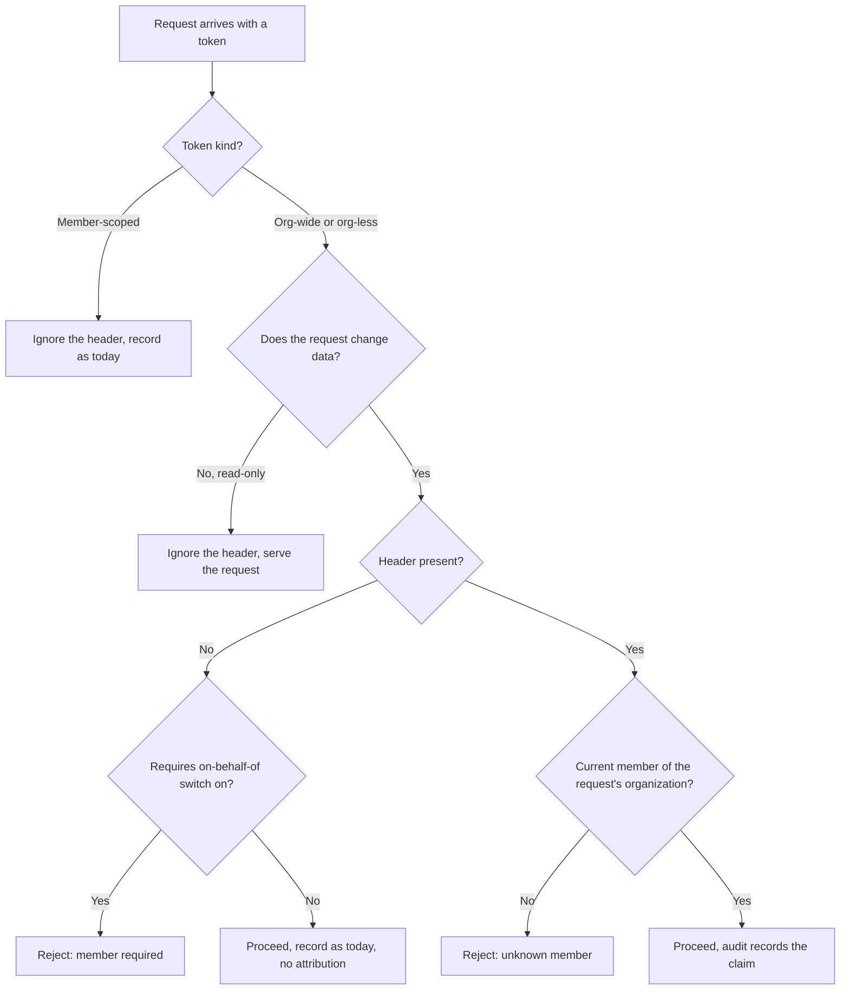
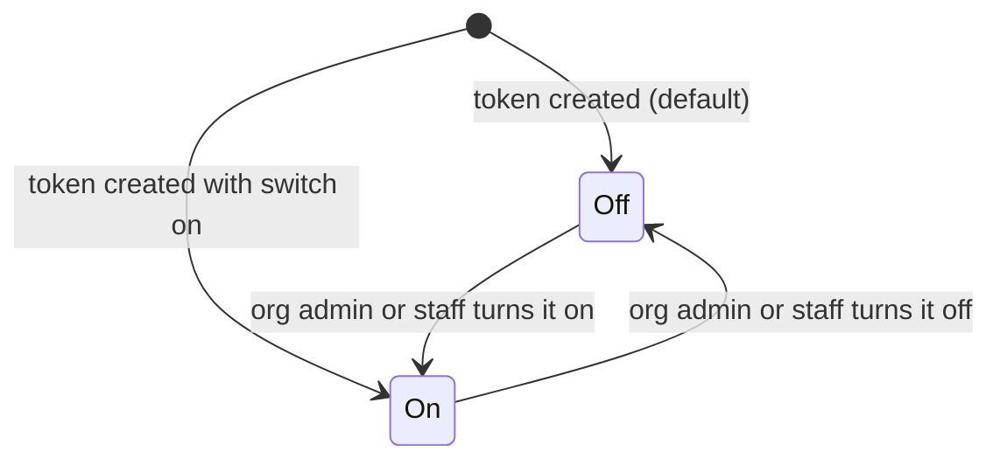

# Public API On-Behalf-Of Member Attribution — Spec

## 1. Business Context

Partner integrations call our public API with tokens. There are three kinds of token:

- **Member-scoped tokens** belong to one organization member and can only touch that member's calendars. The audit trail already records which member the token belongs to.
- **Organization-wide tokens** belong to one organization and can touch every member's calendars.
- **Org-less tokens** are created only by our staff and can reach every organization. The request names the organization.

When an organization-wide or org-less token changes data, the audit trail records only the token. It cannot say which person at the customer the integration was acting for. For example, a scheduling partner books an appointment for a clinic receptionist. Our record says "the partner's token created this event", not "the partner created this event for receptionist Ana".

This is a gap against HIPAA audit controls on our HIPAA client engagements, which expect activity on records to be traceable to an individual. Nobody has asked for it yet. We are closing the gap before an engagement or an audit finds it.

People who need the answer:

- organization admins reviewing what happened in their organization;
- our support and operations staff investigating an incident;
- compliance reviewers on HIPAA engagements;
- integration partners, who want their actions labeled per end user in our records.

Cost of doing nothing: every change made through an organization-wide or org-less token stays attributable only to the integration. On a HIPAA engagement, that would be an audit-control finding.

No other team has to approve or adopt this before it ships.

## 2. Hypothesis (to be validated)

Not a hypothesis. This is a known requirement, driven by HIPAA audit controls: changes must be attributable to an individual even when an integration makes them.

## 3. Objectives (and how to validate Hypothesis)

Definition of done:

1. **Attribution is recorded.** Take any change made by an organization-wide or org-less token whose request named a valid member. Its audit record names that member, marked as a claim made by the token. The token is still recorded as the actor.
   - Signal: the acceptance scenarios under **Decisions → Acceptance scenarios** pass.
2. **Bad attributions never reach the audit trail.** A changing request that names someone who is not a current member of the request's organization is rejected before anything changes.
   - Signal: no audit record holds a claimed member who was not a member of that organization when the action happened.
3. **Organizations can make attribution mandatory.** A token with the "requires on-behalf-of" switch on cannot change data without naming a member.
   - Signal: such a request is rejected and nothing changes.
4. **Staff can find a person's actions.** A staff search for "everything this person did" returns both the actions the person took directly and the actions an integration claimed to take for them. Each claimed action is visibly marked as a claim.
5. **Partners can adopt it without asking us.** The partner-facing public API documentation describes the header, which tokens may send it, the switch, and the errors.
6. **No current integration breaks.** An integration that sends no header and whose token has the switch off behaves exactly as before.

## 4. Decisions

### 4.1 Use-cases

**UC1 — A partner books for a staff member (happy path).**

- Actor: a scheduling partner using an organization-wide token.
- Trigger: receptionist Ana books an appointment in the partner's product.
- Flow:
  1. The partner calls the public API to create the event. Its request header names Ana's member user id.
  2. We check that Ana is a current member of the token's organization.
  3. The event is created exactly as it would be without the header.
  4. The audit record names the partner's token as the actor and adds "on behalf of member Ana (claimed by the token)".
- Outcome: a staff search for Ana's actions returns this record, labeled as a claim made by the integration.

**UC2 — An org-less token acts inside one organization.**

- Actor: an internal or partner integration using an org-less token created by our staff.
- Trigger: the integration updates an event in organization A for member Bruno.
- Flow:
  1. The request names organization A through the existing organization header and names Bruno through the on-behalf-of header.
  2. We check that Bruno is a current member of organization A, the organization the request chose, not any other.
  3. The change goes through, and the audit record carries the claim, as in UC1.
- Outcome: same as UC1.

**UC3 — An org admin makes attribution mandatory.**

- Actor: an organization admin, or our staff.
- Trigger: the organization starts a HIPAA engagement and wants every integration write attributed.
- Flow:
  1. The admin turns on "requires on-behalf-of" for one of the organization's organization-wide tokens. They can do this when creating the token or later. Staff can do the same in the Django admin, and staff alone set it on org-less tokens.
  2. Changing the switch is itself recorded in the audit trail.
  3. From then on, any request from that token that changes data and carries no header is rejected. Read-only requests still go through.
- Outcome: the token can no longer make unattributed changes.

**UC4 — A partner sends a wrong member.**

- Actor: a partner with an organization-wide token.
- Trigger: the partner sends the user id of someone who left the organization, or someone from another organization.
- Flow:
  1. The request changes data, so the header is checked.
  2. The member is not current in the request's organization, so the whole request is rejected with a clear error, before anything changes.
- Outcome: nothing changes, nothing is recorded as done, and the partner learns of the mistake right away.

**UC5 — A staff member investigates an incident.**

- Actor: our support staff, in the Django admin audit view.
- Trigger: a clinic reports that "someone" moved an appointment.
- Flow:
  1. Staff search the audit trail for the person the clinic suspects.
  2. The results include the person's own direct actions and the actions integrations claimed to take for them. Each claimed action shows which token made the claim.
- Outcome: staff can tell the person's own actions apart from what an integration says it did for them.

### 4.2 State transitions & edge cases

**Per-request decision.** This is evaluated once, at the start of each public API request.

**Token setting: "requires on-behalf-of".**

- The switch defaults to off, so every token that exists today keeps its current behavior.
- Org admins and staff can change it on organization-wide tokens. Only staff can change it on org-less tokens, because only staff can create those.
- Every change to the switch is itself an audited action.

**Edge cases and the handling we decided:**

- **A request is a write if it contains any change.** A GraphQL request that mixes queries and mutations counts as a write, and it is accepted or rejected as a whole.
- **Member-scoped token sends the header.** The header is ignored. The token's own member is already on the record.
- **Read-only request sends a bad header.** The header is ignored and not checked. Partners find a wrong id on their first write.
- **Org-less token with no organization chosen.** Nothing changes from today. The header is checked against the organization the request chose, never against any other.
- **Member removed while a request is running.** The check happens once at the start of the request. A claim that was valid then stays on the record.
- **Member removed after the action.** The audit record keeps the claim as written. Removing a member does not rewrite history.
- **One request makes several changes.** Every audit record the request writes carries the same claim.
- **Header present but empty or malformed on a write.** Rejected the same way as an unknown member.

**Idempotency.** Nothing to add. The header is a property of one request, not stored state. Retrying the same request makes the same attribution decision and leaves the target data as the underlying operation already would.

**Concurrency.** Two requests from the same token for different members are independent. Each request's audit records carry only that request's claim. Turning the switch on or off while a request is running affects only requests that start afterwards.

**Time-bounded rules.** None.

### 4.3 Acceptance scenarios

1. **Happy path, organization-wide token.**
   - Given an organization-wide token for organization A, and Ana, a current member of A,
   - When the token creates an event and names Ana in the on-behalf-of header,
   - Then the event is created, and its audit record shows the token as the actor plus "on behalf of Ana, claimed by the token".
2. **Unknown member is rejected.**
   - Given an organization-wide token for organization A, and Carla, who is a member of organization B only,
   - When the token updates an event in A and names Carla,
   - Then the request is rejected with an error saying the member is not part of the organization, the event is unchanged, and no audit record is written for the attempted change.
3. **Switch enforces attribution on writes only.**
   - Given an organization-wide token with "requires on-behalf-of" turned on,
   - When it sends a mutation with no header, the request is rejected with an error saying a member is required, and nothing changes;
   - And when it sends a query-only request with no header, the query is answered normally.
4. **Org-less token is checked against the chosen organization.**
   - Given an org-less token, and Bruno, a member of organization A but not of organization B,
   - When the token chooses organization B and names Bruno on a write,
   - Then the request is rejected;
   - And when it chooses organization A and names Bruno, the write succeeds and carries the claim.
5. **Member-scoped token ignores the header.**
   - Given a token scoped to member Dan,
   - When it writes and names Ana in the header,
   - Then the write is attributed exactly as today, to the token and its member Dan, and Ana appears nowhere.
6. **Staff search returns labeled claims.**
   - Given Ana took one action while signed in, and an integration made one write naming her,
   - When staff search the audit trail for Ana's actions,
   - Then both records are returned, and the integration's record is marked as a claim made by that token.
7. **Existing integrations are unaffected.**
   - Given an organization-wide token with the switch off,
   - When it writes with no header,
   - Then the request behaves and is audited exactly as before this feature.

### 4.4 Negative scope

- **Auditing reads.** The audit trail records changes only. Recording who viewed what is a separate, much larger feature.
- **Verified attribution.** No signed assertion, OAuth token exchange or consent flow proving the member authorized the action. Deferred to v2. This version records the claim honestly, as a claim.
- **No change to what a token may access.** Naming a member never narrows or widens what the token can read or change. Authorization is untouched.
- **Notifications.** Emails and SMS that mention who made a change keep naming whatever they name today.
- **Event organizer and "created by" fields.** Unchanged. The claimed member is not written into any business data.
- **API responses.** The accepted member is not echoed back to the partner.
- **An audit view for organization admins.** Audit records stay readable only by our staff in the Django admin. Exposing them to org admins is separate work.
- **Partner-specific user ids.** No mapping from a partner's own user ids to our members. Partners send our member user id.
- **Identifying the member by email.** Rejected, to keep personal data out of request headers and out of proxy and load-balancer logs.
- **Member-scoped tokens naming another member.** Not supported. The header is ignored for them.
- **Enforcing the switch on reads.** The switch only governs requests that change data.
- **The REST API, webhooks and signed-in users.** Only public API token requests are affected.
- **Backfilling attribution onto past audit records.** Not possible, and not attempted.

## 5. Alternatives considered (optional)

**One token per member.** Already supported: a member-scoped token puts its member on every audit record. Rejected as the answer here because a member-scoped token can only touch its own member's calendars. Integrations that act across the whole organization, such as a front desk booking for every provider, would lose access they legitimately need. Attribution and access are separate questions, and this alternative ties them together.

**An "on behalf of" argument on each mutation.** Every mutation would gain an input naming the member. Rejected because there are dozens of mutations, each would need the same validation, and it is easy to miss one when a new mutation is added. One request-level header is checked in one place and covers every mutation, including future ones.

**A signed assertion or OAuth token exchange.** The member, or the partner on the member's behalf, would present cryptographic proof that the member authorized the action. This is the strongest option and the only one that gives verified rather than claimed attribution. Deferred to v2 rather than rejected: it needs a consent flow, key management and partner work. The claim-based version closes the attribution gap now and leaves room for verification later.

## 6. Open questions

1. **Is a claimed (unverified) attribution enough for each HIPAA client's audit expectations?**
   - Recommended default: yes for v1, recorded and labeled as a claim.
   - Who answers: the project lead, together with the compliance contact on each HIPAA engagement.
   - Unblocks: the priority of the verified-attribution v2.
2. **Does the claim record the member's display name at the time of the action, or only their id?**
   - Recommended default: both. This matches how audit records already describe a member who acts directly, and keeps the record readable after the member leaves.
   - Who answers: the project lead.
   - Unblocks: whether the audit record carries personal data beyond an opaque id.
3. **Should organization admins eventually see audit records, including these claims?**
   - Recommended default: out of scope here. Track it as its own feature if a client asks.
   - Who answers: product.
   - Unblocks: whether the "org admins reviewing audit" audience from **Business Context** is served directly or through our staff.

## 7. Risks assumed

- **An integration names the wrong person.**
  - Assumption: partners send the member who really triggered the action.
  - Mitigation: we check that the member exists in the organization, label the record as a claim made by a specific token, and keep the token as the actor, so blame lands on the integration when the claim is false. Verification is deferred to v2.
  - Likelihood: medium. Severity: medium.
- **Partners don't adopt the header, so attribution stays sparse.**
  - Assumption: organizations that need attribution will turn on the switch, and partners will follow the documentation.
  - Mitigation: the per-token switch lets an organization make it mandatory. The partner documentation is updated in the same change.
  - Likelihood: medium. Severity: low.
- **Turning the switch on breaks an integration that writes without the header.**
  - Assumption: whoever turns it on has confirmed the partner sends the header.
  - Mitigation: the rejection error says plainly that a member is required. Turning the switch off restores the old behavior immediately, and both changes are audited.
  - Likelihood: medium. Severity: medium.
- **Searches for a person return integration claims mixed with their own actions.**
  - Assumption: the claim label is visible enough that a reviewer won't mistake one for the other.
  - Mitigation: each claimed record names the token that made the claim.
  - Likelihood: low. Severity: medium.
- **Reversibility.**
  - Assumption: none.
  - Mitigation: the header is purely additive and the switch defaults to off. Removing the feature means ignoring the header and dropping the switch. Claims already written stay in the audit trail, which is the correct outcome for an audit record. The new token setting is a schema change, so it needs a reversible migration.
  - Likelihood: low. Severity: low.
